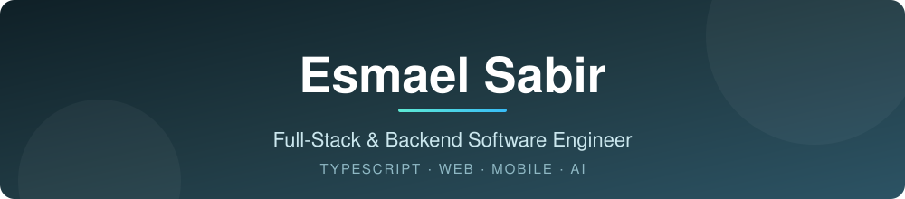

  

  
  
  
  

## 👋 About Me

I'm a full-stack software engineer based in **Addis Ababa, Ethiopia**, building scalable web systems and AI-powered products. I turn real-world problems into practical software, from intuitive interfaces to the APIs, databases, and integrations behind them.

My home base is the **TypeScript** ecosystem: React and Next.js on the front end, NestJS and Node.js on the back end, and mobile and installable apps with React Native, Expo, and PWAs.

- 🧩 **What I do:** end-to-end product development, with a strong backend and system design focus
- 🤖 **Exploring:** AI-powered applications and scalable backend architectures
- 📱 **Also building:** offline-first mobile experiences
- 📧 **Email:** [esmaelsabir9@gmail.com](mailto:esmaelsabir9@gmail.com)
- 🔗 **More about me:** [esmaelsabir.pro.et](https://esmaelsabir.pro.et/)

## 🛠️ Tech Stack

**Languages**

  

**Frontend**

  

**Mobile & PWA**

  
  
  

**Backend**

  

**Data**

  

**Tools & Infrastructure**

  

## 📊 GitHub Stats

  
  

## 🤝 Let's Connect

I'm open to interesting projects and collaboration. Feel free to reach out.

  
  
  
  

